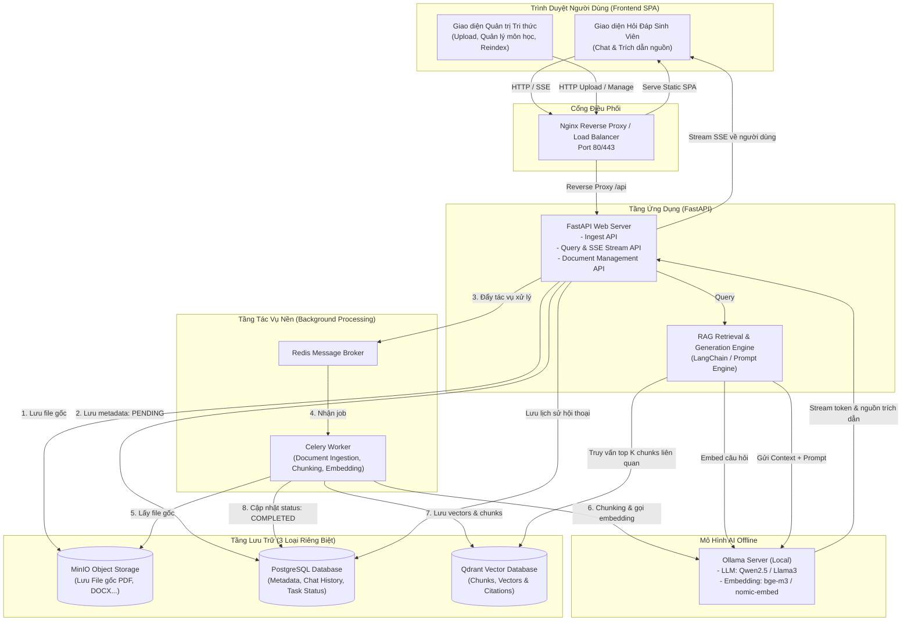

# KẾ HOẠCH TRIỂN KHAI HỆ THỐNG RAG HỌC THUẬT (ACADEMIC RAG ASSISTANT)

> **Mục tiêu:** Xây dựng hệ thống Hỏi - Đáp thông minh hỗ trợ sinh viên và giảng viên tra cứu giáo trình, bài giảng, đề cương và bài tập môn học. Hệ thống vận hành hoàn toàn offline thông qua Ollama (hoặc linh hoạt chuyển đổi API), đáp ứng đầy đủ tiêu chuẩn kiến trúc doanh nghiệp: 3 tầng lưu trữ (SQL, Object Storage, Vector DB), Message Queue xử lý nền, Nginx điều phối và CI/CD tự động hóa.

---

## 1. TỔNG QUAN HỆ THỐNG & TECH STACK

| Thành phần | Công nghệ lựa chọn | Vai trò & Lý do |
| :--- | :--- | :--- |
| **LLM & Embedding (Offline)** | **Ollama** (`qwen2.5` / `llama3` + `bge-m3` / `nomic-embed-text`) | Xử lý ngôn ngữ tự nhiên và vector hóa hoàn toàn cục bộ, không phụ thuộc internet/chi phí API. Hỗ trợ tiếng Việt xuất sắc. |
| **Backend API** | **Python (FastAPI)** | Async hiệu năng cao, tích hợp chuẩn Server-Sent Events (SSE) cho streaming câu trả lời, OpenAPI tự động. |
| **RAG Engine** | **LangChain / Custom Pipeline** | Quản lý chunking (RecursiveCharacterTextSplitter), hybrid retrieval, prompt template học thuật và source citation. |
| **Object Storage** | **MinIO (S3-compatible)** | Lưu trữ an toàn các tệp tài liệu gốc (PDF, DOCX, TXT, PPTX). |
| **Relational Database** | **PostgreSQL (v16)** | Lưu trữ metadata tài liệu, danh mục môn học, lịch sử đoạn chat, feedback và trạng thái tiến trình xử lý tác vụ nền. |
| **Vector Database** | **Qdrant** | Lưu trữ vector nhúng, tìm kiếm ngữ nghĩa cosine distance với tốc độ cao, hỗ trợ payload filter theo môn học. |
| **Message Queue & Worker** | **Redis + Celery** | Hàng đợi tác vụ nền xử lý đọc file -> chunking -> sinh embedding -> index vector mà không làm nghẽn API. |
| **Reverse Proxy & LB** | **Nginx** | Điều phối traffic, SSL termination, reverse proxy cho Frontend tĩnh và Backend API (`/api/v1`). |
| **Frontend UI** | **Vanilla HTML5, Modern CSS, ES6 JS** | Giao diện Single Page Application phong cách Premium Academic Portal (Dark/Light mode, Chat Streaming, Quản lý tài liệu theo môn học). |
| **Container & CI/CD** | **Docker Compose & GitHub Actions** | Đóng gói toàn bộ hệ thống chạy với 1 lệnh `docker compose up -d`, kiểm thử tự động lint/test và build image qua CI/CD. |

---

## 2. KIẾN TRÚC HỆ THỐNG & SƠ ĐỒ LUỒNG (DATA FLOW)



---

## 3. CẤU TRÚC DỰ ÁN DỰ KIẾN (PROJECT DIRECTORY)

```text
d:\RAG\
├── .github/
│   └── workflows/
│       └── ci.yml               # Luồng CI/CD: lint, test, docker build
├── docker/
│   ├── nginx/
│   │   ├── nginx.conf           # Cấu hình reverse proxy và load balancer
│   │   └── default.conf
│   └── Dockerfile.backend       # Dockerfile cho FastAPI & Celery Worker
├── backend/
│   ├── app/
│   │   ├── api/                 # Endpoints: auth, docs, chat, tasks
│   │   │   ├── v1/
│   │   │   │   ├── chat.py      # Streaming Q&A, source citations
│   │   │   │   ├── documents.py # Upload, delete, reindex
│   │   │   │   └── health.py
│   │   ├── core/                # Config, logging, Celery app
│   │   │   ├── config.py
│   │   │   └── celery_app.py
│   │   ├── db/                  # PostgreSQL connection & models
│   │   │   ├── session.py
│   │   │   └── models.py
│   │   ├── services/            # Business logic
│   │   │   ├── storage.py       # MinIO Client
│   │   │   ├── vector_store.py  # Qdrant Client
│   │   │   ├── llm_provider.py  # Ollama LLM & Embedding adapter
│   │   │   └── rag_engine.py    # Pipeline Retrieval-Augmented Generation
│   │   ├── workers/             # Celery background tasks
│   │   │   └── ingestion.py     # Parser (PDF, DOCX), Chunker, Embedder
│   │   └── main.py              # FastAPI Entrypoint
│   ├── tests/                   # Pytest unit & integration tests
│   ├── requirements.txt         # Thư viện Python
│   └── alembic/                 # Quản lý migration DB
├── frontend/
│   ├── css/
│   │   ├── style.css            # Academic design system, dark/light theme
│   │   └── components.css
│   ├── js/
│   │   ├── api.js               # Gọi API Backend & EventSource (SSE)
│   │   ├── chat.js              # Xử lý chat, markdown renderer, trích dẫn
│   │   └── admin.js             # Quản lý upload tài liệu, tiến độ ingest
│   ├── index.html               # Giao diện chính (Tra cứu học thuật)
│   └── admin.html               # Giao diện quản trị kho tài liệu
├── docker-compose.yml           # Khởi chạy toàn bộ stack dịch vụ
├── .env.example                 # Mẫu cấu hình môi trường
├── requirements.md              # Yêu cầu gốc của dự án
└── PLAN.md                      # Kế hoạch chi tiết này
```

---

## 4. KẾ HOẠCH TRIỂN KHAI TỪNG BƯỚC (6 GIAI ĐOẠN)

### Giai đoạn 1: Thiết lập nền tảng hạ tầng & Docker Compose
- Cấu hình file `docker-compose.yml` gồm đầy đủ các dịch vụ:
  1. `postgres`: Database quan hệ cho metadata và lịch sử.
  2. `minio`: Object storage lưu trữ file gốc.
  3. `qdrant`: Vector database chuyên dụng.
  4. `redis`: Message broker cho Celery.
  5. `backend`: FastAPI API server.
  6. `celery_worker`: Worker chạy nền thực hiện tác vụ nặng.
  7. `nginx`: Reverse proxy cổng 80 điều hướng `/` và `/api`.
- Tạo file `.env.example` và thiết lập kết nối Ollama (local host hoặc container).

### Giai đoạn 2: Tầng Lưu trữ & Quản lý Dữ liệu Backend
- **PostgreSQL**: Thiết kế bảng `documents`, `document_chunks`, `courses_subjects`, `chat_sessions`, `chat_messages`, `ingestion_tasks`.
- **MinIO Service**: Wrapper upload, download, tạo bucket `academic-docs` và presigned URLs an toàn.
- **Qdrant Service**: Khởi tạo collection `academic_knowledge` với cấu hình cosine similarity, vector size phù hợp mô hình embedding (`bge-m3` là 1024 chiều hoặc `nomic-embed-text` là 768 chiều).

### Giai đoạn 3: Background Worker & Pipeline Ingestion
- Thiết lập **Celery + Redis** task `process_document_task(doc_id)`.
- Hỗ trợ các định dạng học thuật phổ biến: PDF (giáo trình, đề thi), DOCX, TXT, Markdown.
- Kỹ thuật **Chunking thông minh**: Phân tách theo cấu trúc mục, tiêu đề (header-aware), kích thước chunk ~500-800 tokens, overlap 100-150 tokens.
- Tích hợp **Ollama Embedding**: Gửi batch chunks sang Ollama API để sinh vector và lưu vào Qdrant kèm payload (document_id, file_name, page_number, chunk_text).
- Cập nhật tiến độ `PENDING` -> `PROCESSING` -> `COMPLETED` / `FAILED` trong PostgreSQL để Frontend hiển thị realtime.

### Giai đoạn 4: Core RAG Engine & Streaming API
- **Retriever**:
  - Truy vấn ngữ nghĩa trên Qdrant theo câu hỏi của sinh viên.
  - Hỗ trợ lọc theo môn học/học phần (Metadata Filtering).
  - Tích hợp Re-ranking hoặc Score Threshold để loại bỏ các đoạn không liên quan.
- **Generator**:
  - Thiết kế System Prompt chuẩn mực học thuật: Yêu cầu trả lời chính xác, trung thực dựa trên tài liệu, từ chối ảo giác, luôn kèm theo trích dẫn cụ thể (Tên tài liệu, Chương/Trang).
  - Kết nối mô hình Ollama (Qwen2.5 / Llama 3) qua Streaming.
- **FastAPI Endpoint**:
  - `/api/v1/chat/stream`: Trả về Server-Sent Events (SSE) theo từng token.
  - Trả kèm metadata nguồn trích dẫn (`citations`: danh sách các đoạn liên quan nhất cùng % tương đồng).

### Giai đoạn 5: Frontend Học thuật Sang trọng (Academic Portal)
- Thiết kế giao diện theo phong cách hiện đại (Premium Academic Glassmorphism, Dark/Light Mode, Font Inter):
  1. **Tab Học tập (Chat Interface)**:
     - Khung chat streaming mượt mà từng chữ.
     - Bộ lọc chọn môn học/kho tài liệu muốn hỏi.
     - Hộp hiển thị trích dẫn nguồn (Collapsible Source Citations) kèm số trang, đoạn văn tương ứng và điểm liên quan.
     - Hiển thị Markdown, công thức toán học và bảng biểu đẹp mắt.
  2. **Tab Quản lý Tài liệu (Admin / Knowledge Base)**:
     - Upload file kéo thả (Drag & Drop) tài liệu môn học (PDF, DOCX...).
     - Bảng danh sách tài liệu kèm badge trạng thái ingest realtime (Đang xử lý, Thành công, Lỗi).
     - Nút Re-index (đẩy lại vào Queue nền) và Xóa tài liệu (đồng bộ xóa cả MinIO, Postgres và Qdrant).

### Giai đoạn 6: Reverse Proxy Nginx, CI/CD & Kiểm thử
- Cấu hình Nginx reverse proxy chuẩn cho SSE (tắt buffering `proxy_buffering off;`).
- Xây dựng luồng CI/CD với GitHub Actions (`.github/workflows/ci.yml`):
  - Linting (flake8 / ruff)
  - Unit tests (pytest cho các module chunker, storage, rag pipeline)
  - Docker build test (đảm bảo image build thành công)
- Hướng dẫn vận hành nhanh với 1 lệnh `docker compose up -d` và cách tải model Ollama.

---

## 5. CHECKLIST ĐÁP ỨNG ĐẦY ĐỦ YÊU CẦU ĐỀ BÀI

- [x] **Trường hợp sử dụng:** Hỗ trợ tra cứu học thuật / giáo trình môn học (TH2).
- [x] **Luồng RAG hoàn chỉnh:** Ingest -> Chunking -> Embedding -> Vector Search -> Generation (Streaming) kèm Source Citations.
- [x] **Frontend:** Giao diện tra cứu hỏi đáp + Giao diện quản trị tài liệu/trạng thái ingest.
- [x] **Bộ 3 loại lưu trữ riêng biệt:**
  - Database: PostgreSQL (metadata, chat history, tasks).
  - Object Storage: MinIO (lưu trữ file gốc).
  - Vector Database: Qdrant (lưu vector và payloads).
- [x] **Message Queue xử lý nền:** Celery + Redis cho các tác vụ ingest/re-embedding không làm treo API.
- [x] **Load Balancer / Gateway:** Nginx điều phối request Frontend và Backend.
- [x] **Điểm cộng:** Pipeline CI/CD hoàn chỉnh với GitHub Actions.
