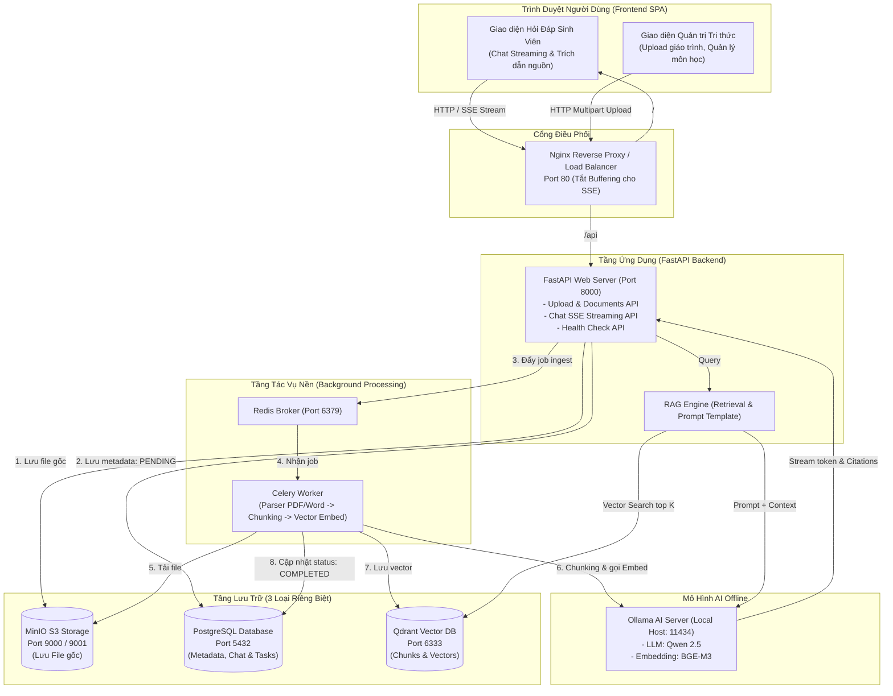

# 🎓 Academic RAG Assistant (Hệ Thống RAG Học Thuật)

[](https://github.com/dattran301220/RAG/actions)


> **Hệ thống Hỏi – Đáp thông minh dựa trên tài liệu học thuật nội bộ** (giáo trình, bài giảng, đề cương môn học, bài tập). Vận hành hoàn toàn **Offline qua Ollama**, kiến trúc Microservices chuẩn doanh nghiệp với 3 tầng lưu trữ chuyên biệt, hàng đợi xử lý nền bất đồng bộ và pipeline CI/CD tự động hóa đạt chuẩn.

---

## 🌟 ĐIỂM NỔI BẬT CỦA HỆ THỐNG

1. **Hỏi đáp học thuật chuyên sâu (Academic Assistant):**
   - Hỗ trợ phân loại và truy vấn ngữ nghĩa theo từng môn học/học phần (`Course`).
   - Câu trả lời đi kèm **nguồn trích dẫn chi tiết** (Tên giáo trình, số trang, đoạn văn đối chiếu và độ tương đồng).
   - Trả lời dạng **Streaming từng chữ (SSE)** theo thời gian thực như ChatGPT.

2. **Kiến trúc Lưu trữ 3 Tầng Chuyên Biệt (Storage Architecture):**
   - **PostgreSQL 16:** Lưu trữ metadata môn học, thông tin file, lịch sử chat và tiến trình tác vụ.
   - **MinIO (S3-compatible):** Lưu trữ file gốc (PDF, DOCX, TXT) an toàn, hỗ trợ file dung lượng lớn.
   - **Qdrant Vector DB:** Lưu trữ các vector nhúng (Embeddings) và thực hiện tìm kiếm tương đồng Cosine cực nhanh.

3. **Hàng đợi Tác vụ Nền (Message Queue & Worker):**
   - Tách rời hoàn toàn các tác vụ nặng (Đọc file -> Cắt chunk -> Gọi embedding -> Index vector) sang **Celery Worker + Redis**.
   - API phản hồi tức thì, người dùng theo dõi tiến trình nạp tài liệu theo thời gian thực (`PENDING` ➔ `PROCESSING` ➔ `COMPLETED`).

4. **Vận hành Offline 100% với Ollama:**
   - LLM: `Qwen 2.5` / `Llama 3` (Hiểu tiếng Việt và học thuật xuất sắc).
   - Embedding: `BGE-M3` / `Nomic-embed-text` (Vector hóa đa ngữ ngữ nghĩa cao).
   - Không tốn chi phí API, bảo mật dữ liệu giáo trình nội bộ tuyệt đối.

5. **Tự động hóa CI/CD Hoàn Chỉnh (Điểm cộng):**
   - GitHub Actions tự động kiểm tra cú pháp (Flake8), chạy bài kiểm thử Unit tests (Pytest), và kiểm tra tính toàn vẹn khi đóng gói Docker Backend & Nginx.

---

## 🏗️ KIẾN TRÚC HỆ THỐNG (SYSTEM ARCHITECTURE)



---

## 📁 CẤU TRÚC DỰ ÁN

```text
d:\RAG\
├── .github/
│   └── workflows/
│       └── ci.yml               # Pipeline CI/CD tự động kiểm thử và build Docker
├── docker/
│   ├── nginx/
│   │   └── nginx.conf           # Cấu hình reverse proxy & tối ưu SSE Streaming
│   └── Dockerfile.backend       # Docker image dùng chung cho FastAPI & Celery
├── backend/
│   ├── app/
│   │   ├── api/                 # Endpoints: chat streaming, documents, health
│   │   │   └── v1/
│   │   │       ├── chat.py
│   │   │       ├── documents.py
│   │   │       └── health.py
│   │   ├── core/                # Quản lý cấu hình Pydantic & Celery App
│   │   │   ├── config.py
│   │   │   └── celery_app.py
│   │   ├── db/                  # PostgreSQL session & 5 bảng dữ liệu ORM
│   │   │   ├── session.py
│   │   │   └── models.py
│   │   ├── services/            # Tầng logic lưu trữ & AI
│   │   │   ├── storage.py       # Wrapper MinIO S3
│   │   │   ├── vector_store.py  # Wrapper Qdrant Client
│   │   │   ├── llm_provider.py  # Adapter Ollama LLM & Embedding
│   │   │   └── rag_engine.py    # Pipeline Retrieval-Augmented Generation
│   │   ├── workers/             # Celery background tasks (Ingestion pipeline)
│   │   │   └── ingestion.py
│   │   └── main.py              # Entrypoint FastAPI
│   ├── tests/                   # Thư mục Pytest Unit & Integration tests
│   │   └── test_models.py
│   └── requirements.txt         # Danh sách thư viện Python
├── frontend/                    # Giao diện Single Page Application
│   ├── index.html               # Giao diện tra cứu học thuật
│   ├── admin.html               # Giao diện quản trị tài liệu
│   ├── css/
│   └── js/
├── docker-compose.yml           # Khởi chạy cụm 6 dịch vụ
├── pytest.ini                   # Cấu hình đường dẫn test runner
├── .env.example                 # Mẫu khai báo biến môi trường
├── requirements.md              # Yêu cầu đề bài ban đầu
└── PLAN.md                      # Bản kế hoạch chi tiết 6 giai đoạn
```

---

## 🚀 HƯỚNG DẪN KHỞI CHẠY (QUICK START)

### 1. Yêu cầu tiên quyết
* Đã cài đặt **Docker** và **Docker Compose**.
* Đã cài đặt **Ollama** trên máy host ([https://ollama.com](https://ollama.com)).
* Tải 2 mô hình AI cần thiết qua terminal:
  ```bash
  ollama pull qwen2.5:latest
  ollama pull bge-m3:latest
  ```

---

### 2. Thiết lập Biến môi trường
Copy tệp mẫu `.env.example` thành `.env`:
```bash
cp .env.example .env
```
*(Các cấu hình mặc định trong `.env` đã được thiết lập sẵn sàng để kết nối giữa các container)*.

---

### 3. Khởi chạy toàn bộ hệ thống bằng 1 lệnh duy nhất
Tại thư mục gốc dự án, chạy lệnh:
```bash
docker compose up -d --build
```

Kiểm tra trạng thái các container đang chạy:
```bash
docker compose ps
```

---

## 🌐 CÁC CỔNG TRUY CẬP DỊCH VỤ

| Dịch vụ | Địa chỉ truy cập | Tài khoản mặc định | Mô tả |
| :--- | :--- | :--- | :--- |
| **Giao diện Web (Frontend)** | [http://localhost](http://localhost) | - | Cổng vào chính phục vụ sinh viên & quản trị |
| **API Documentation (Swagger)** | [http://localhost/docs](http://localhost/docs) | - | Thử nghiệm các API của FastAPI |
| **MinIO Console (S3 Storage)** | [http://localhost:9001](http://localhost:9001) | `minio_admin` / `minio_password123` | Quản lý file gốc PDF/Word đã tải lên |
| **Qdrant Dashboard (Vector DB)** | [http://localhost:6333/dashboard](http://localhost:6333/dashboard) | - | Quản lý vector embeddings & collections |
| **PostgreSQL Database** | `localhost:5432` | `rag_admin` / `rag_password123` / DB: `rag_academic_db` | Truy vấn trực tiếp qua DBeaver / pgAdmin |

---

## 🧪 CHẠY KIỂM THỬ (UNIT TESTS)

Để chạy kiểm thử tự động tại môi trường cục bộ:
```powershell
# Kích hoạt môi trường ảo
.\venv\Scripts\Activate.ps1

# Chạy Pytest
pytest -v
```

---

## 📋 BẢNG THAM CHIẾU YÊU CẦU ĐỀ BÀI

- [x] **Trường hợp bài toán:** Hỗ trợ tra cứu học thuật / tài liệu môn học (Trường hợp 2).
- [x] **Luồng RAG hoàn chỉnh:** Ingest -> Chunking -> Embedding -> Vector Search -> Trả lời Streaming kèm trích dẫn nguồn.
- [x] **Đủ 3 loại lưu trữ riêng biệt:**
  - Database: PostgreSQL (Metadata, lịch sử chat, tác vụ).
  - Object Storage: MinIO (Lưu file PDF/Word gốc).
  - Vector Database: Qdrant (Lưu vector và chunks).
- [x] **Message Queue xử lý nền:** Celery + Redis cho tác vụ ingest/embedding không làm treo API.
- [x] **Load Balancer & Gateway:** Nginx điều phối request và tối ưu SSE streaming.
- [x] **Điểm cộng:** Pipeline CI/CD tự động hóa hoàn chỉnh với GitHub Actions.

---

## 👤 Tác Giả & Bản Quyền
* **Dự án:** Academic RAG Assistant
* **Phát triển bởi:** [dattran301220](https://github.com/dattran301220/RAG)
* **Giấy phép:** MIT License
